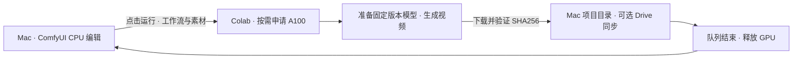

# H3 Colab Workbench

在 Mac 上用原版 **ComfyUI** 编辑视频工作流，点击运行后才申请 **Google Colab A100** 生成视频。结果取回、校验并保存后释放 GPU，本机画布继续保留。

适合个人使用自己的 Colab 计算额度进行 MiniMax H3 文生视频、图生视频。工作台运行在本机，不需要每轮登录临时公网入口。

**v0.1.0 验证**：23 项本地测试、独立 CPU 安装与工作流校验通过，正式包已完成一次约五秒的真实 GPU 生成、结果校验和自动释放。详见[验证记录](docs/verification.md)。



## 功能

- 原版 ComfyUI 节点画布、提示词编辑、队列、历史和视频预览。
- Google 首次授权后复用连接；每轮申请 GPU 前核对配置的账号和可用额度。
- 固定 ComfyUI、前端、Colab CLI、模型版本；模型下载验证文件大小和 SHA256。
- 连续排队任务复用 GPU；成功、失败或取消后执行释放，并显示是否确认。
- 文件传输最多重试一次，不自动重试视频生成。
- 模型留在 Colab，本机只安装 CPU 编辑环境。视频、素材和工作流保存到自己选择的目录。

## 支持范围

| 项目 | 当前支持 |
|---|---|
| 本机 | Apple Silicon Mac、macOS 14 或更高、Python 3.12、Chrome |
| 云端 | 可分配 A100 的 Google Colab 账号，有现成计算额度 |
| 工作流 | H3 文生视频、图生视频，含模型原生声音 |
| 模型集合 | FL2VA + Turbo，合计约 42.03 GB，在 Colab 下载 |
| 保存 | 本机目录；选择 Google Drive 同步目录即可同步 |
| 暂未验收 | 1080p 显存与成本、长时间连续运行、参考音视频工作流、Windows/Linux 安装 |

编辑不占用 Colab GPU；安装环境、下载模型、加载和生成均计入 GPU 使用时间。具体额度以 Colab 的查询结果为准，软件不会购买额度或调用付费视频 API。

## 快速开始

需要 Git 和 Python 3.12。首次安装会下载 CPU 编辑依赖，可能耗时数分钟。

```bash
git clone https://github.com/ytq9/h3-colab-workbench.git
cd h3-colab-workbench
python3.12 -m venv .venv
.venv/bin/python -m pip install -r requirements/colab-cli.txt
.venv/bin/python -m pip install --no-deps .

.venv/bin/h3-workbench init --email you@example.com --project-dir "$HOME/Movies/H3Workbench"
.venv/bin/h3-workbench install
.venv/bin/h3-workbench start
```

将 `you@example.com` 换成实际有 Colab 额度的 Google 账号。若要使用 Drive，把 `--project-dir` 改成 Mac 上自己的 Drive 同步目录。私有仓库需要先登录 GitHub。

也可以双击 [`scripts/setup.command`](scripts/setup.command) 完成首次安装，之后双击 [`scripts/open.command`](scripts/open.command) 打开。

第一次进入工作台，点击底部“连接 Google”，在 Google 页面授权，再把授权码填回本机连接页。此过程不申请 GPU。授权码和口令不要填写到 GitHub Issue。

## 日常使用

1. 打开工作流 **H3 → 01_文生_省额度**，或 **02_图生_省额度**；图生先上传自己的图片。
2. 修改提示词、画幅、时长与采样参数，保存工作流。
3. 点击 **运行**。底部状态条依次显示申请 GPU、安装环境、准备模型、传送素材、生成、取回结果、释放。
4. 结果保存到 `项目目录/output/video/<任务编号>/…`，队列结束后显示“GPU 已释放”。

生成和取回结果期间，让 Mac 保持开机、联网。关闭浏览器标签不会停止后台；需要停止任务时使用 ComfyUI 的中止按钮。每轮冷启动都有准备成本，确定的一组镜头可以连续排队。

常用命令：

```bash
.venv/bin/h3-workbench status   # 本机工作台状态
.venv/bin/h3-workbench usage    # 查询额度，不申请 GPU
.venv/bin/h3-workbench doctor   # 本地诊断，不连接 Colab
.venv/bin/h3-workbench release # 重试释放自己的空闲 GPU 会话
.venv/bin/h3-workbench stop    # 队列为空且 GPU 释放确认后停止本机后台
```

## 文档

- [安装、配置与迁移](docs/setup.md)
- [ComfyUI 操作与 1080p 参数](docs/usage.md)
- [架构、生命周期与目录](docs/architecture.md)
- [故障排查与已知限制](docs/troubleshooting.md)
- [验证范围](docs/verification.md)
- [贡献说明](CONTRIBUTING.md) · [更新记录](CHANGELOG.md) · [安全说明](SECURITY.md)

## 开发

基础包只依赖 Python 标准库。以下检查不启动 Colab，也不下载模型：

```bash
python3.12 -m pip install .
python3.12 -m unittest discover -s tests -v
python3.12 scripts/check_release.py
python3.12 -m pip wheel --no-deps . -w dist
```

仓库不包含模型权重、用户视频、登录凭据或旧排错记录。源码采用 GPL-3.0-only；依赖和模型各自适用其许可证，见 [第三方声明](THIRD_PARTY_NOTICES.md)。
