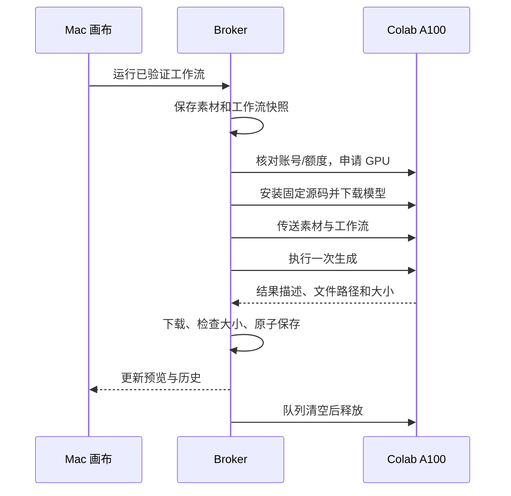

# 架构与生命周期

## 模块

| 模块 | 职责 |
|---|---|
| `config.py` / `cli.py` | 配置、安装入口、本机启动停止、诊断 |
| `install.py` | 安装固定版本 ComfyUI 与 CPU 依赖 |
| `editor.py` | 原版 CPU 画布、回环访问约束、Google 连接路由 |
| `executor.py` | 保留 ComfyUI 队列/历史接口，将任务交给 broker |
| `broker.py` | 身份额度检查、单批 GPU、传输、取回保存、释放 |
| `colab_cli.py` | 官方 CLI 包装、隔离 OAuth 与会话、禁止隐式交互登录 |
| `colab_transport.py` / `diagnostics.py` | 固定依赖的连接就绪/超时/清理兼容层，私有脱敏传输事件 |
| `worker.py` / `resources/worker_*.py` | 可独立执行的远程准备、生成、资源释放脚本 |

## 一次生成



文件传输采用相同目标重试一次；申请 GPU、安装和生成不会自动重试。上传每次最多 60 秒，视频下载每次最多 120 秒。远程传输保护窗口为两次超时加 60 秒，防止传输期间被普通空闲计时误判。

远程空闲兜底为 3 分钟，上传保护窗口 3 分钟、视频下载保护窗口 5 分钟。单次生成最多 20 分钟，整个会话最多 45 分钟。正常路径在队列结束后立即请求释放；这些上限处理异常中断，不能替代对 Colab 实际会话状态的确认。

stop 失败后，若已确认分配过 GPU，会查询实时会话数量。明确为 0 才确认释放；查询失败、响应不可解析或仍有会话时保持未确认，不把未知当成功。

申请前持久化本工作台的会话归属记录，分配完成后更新。后台异常退出再启动时，会恢复“释放未确认”提醒并阻止重复申请；先释放旧会话再生成。该恢复不会恢复视频推理，也不会主动访问云端。

## 数据

```text
project_dir/
  input/                    用户素材
  user/default/workflows/   保存的工作流与预设
  output/video/<job-id>/    保存的结果
  jobs/<job-id>/            输入快照、请求与结果记录
  executed-workflows/      已提交的 UI/API 工作流

runtime_dir/                CPU 环境、固定源码、数据库、进程记录
credential_dir/             OAuth、官方 CLI 会话历史、私有错误日志
```

错误日志按操作和时间分别保存。释放错误不会覆盖上传或生成错误；日志脱敏后保存在私有目录，不自动附加到 Issue 或上传 GitHub。

WebSocket 初次就绪等待为依赖默认 10 秒，再给延迟握手最多 20 秒；未就绪时不发送代码。前置命令失败也关闭监听线程；执行回复受单一时限约束。执行请求发送后发生异常不会自动重放。传输事件日志按 1 MiB 轮转、最多保留三份，不记录请求头、代码或输出正文。

本机正常停止时把 ComfyUI 历史保存到 `runtime_dir/editor-history.json`，下次启动恢复。它不恢复待执行队列，也不恢复中断的视频推理。

## 边界

本机只监听 127.0.0.1；写请求校验 Host 和 Origin。没有公网隧道、远程工作台口令或云端 Drive 挂载。传给 Colab 的请求仅保留工作流与必要素材，不携带本机 Google token。

模型来源、版本、大小及两个原版工作流的来源位于 `resources/manifest.json`。模型准备和视频取回仅检查文件大小，不额外读取整个文件计算哈希。源码包使用固定提交的下载地址与安全解包，不做内容摘要校验。下载库及协议自身的数据处理由相应依赖管理。

CPU 依赖使用已验证快照；GPU 环境沿用固定 ComfyUI 提交的 requirements，Colab 自带 CUDA/PyTorch 基础环境不由本仓库锁定。
